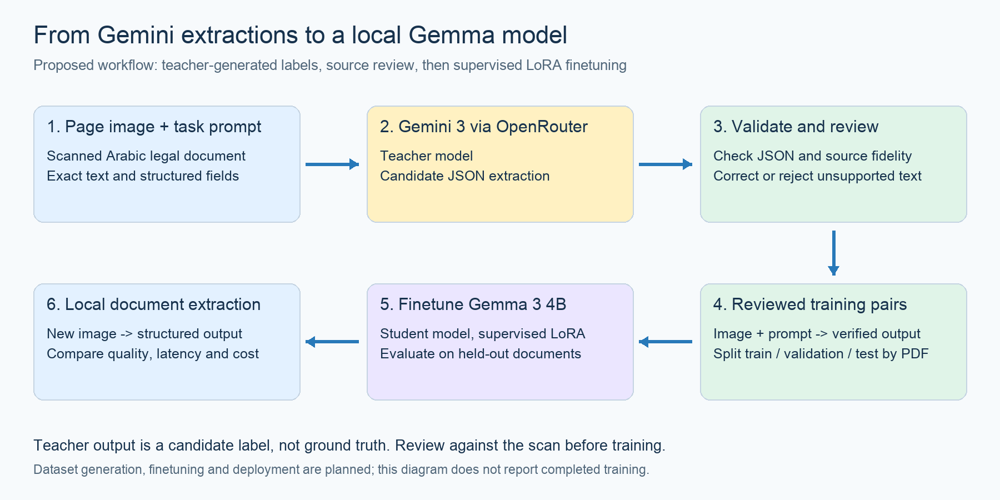

# VLMs for Complex Arabic OCR

For a complete French explanation of the workflow, technical choices, and strategy, read [Guide du projet en français](GUIDE_PROJET_FR.md).


## Master VLM Finetuning: Extracting Data from Challenging Arabic Legal Documents

We dive deep into the world of Vision Language Models (VLMs) to solve a real-world problem: processing low-quality, scanned Arabic legal documents. Standard OCR often fails with complex layouts and poor scan quality; here, we leverage the reasoning power of VLMs to extract structured data with high precision.

## Project context and priorities

1. **Local model:** target a VLM that can run on local hardware, with model weights available locally rather than requiring a hosted inference API. Model selection must account for available memory, supported hardware, and inference speed. Local inference is a goal; it is not implemented yet.
2. **Low budget:** prioritize small models, efficient image preparation, and parameter-efficient finetuning such as LoRA. Evaluate a baseline before spending on training, and track compute costs alongside quality. A specific spending limit and hardware budget have not been set.
3. **More than an OCR model:** aim to understand document content and layout and extract structured legal information, beyond transcribing text. Candidate tasks include identifying document types, extracting fields such as decision numbers and dates, and answering questions grounded in document pages. These are proposed capabilities; their output schema and evaluation criteria will be defined before implementation.

The current PDF-to-image pipeline provides inputs for this future VLM workflow. Model choice, training configuration, and deployment must follow these priorities.

## What you will learn

- **Data Strategy:** How to parse complex PDFs and generate synthetic data for niche tasks.
- **The Stack:** Using LlamaFactory for finetuning, Vast.ai for GPU compute, and WandB for experiment tracking.
- **Deployment:** Merging LoRA weights and optimizing inference using vLLM.

## Candidate vision-language models

The initial shortlist includes these three model families. They are candidates for evaluation, not a verified ranking for Arabic legal OCR.

| Model family | Reference | Selection considerations |
| --- | --- | --- |
| Qwen3-VL | [Hugging Face collection](https://huggingface.co/collections/Qwen/qwen3-vl) | Compare a small vision-language checkpoint on Arabic transcription, document understanding, and structured extraction. Check memory needs and compatibility with the chosen runtime. |
| LLaVA-NeXT | [Hugging Face collection](https://huggingface.co/collections/llava-hf/llava-next) | Select an exact checkpoint and evaluate its Arabic capabilities; these depend on the underlying language model and training data. |
| Gemma 3 | [Hugging Face collection](https://huggingface.co/collections/google/gemma-3-release) | Select a vision-capable variant: the Gemma 3 1B model is text-only, while the 4B, 12B, and 27B variants support image inputs. Check checkpoint access requirements and license terms. |

Before choosing a model, use the same held-out document pages and prompts to compare Arabic transcription accuracy, extraction accuracy, valid structured outputs, inference time, and peak memory. Include small text, diacritics, stamps, and poor scans. Measure the effect of image resolution rather than assuming the current 600-pixel preprocessing setting is sufficient.

The selected checkpoint must fit local hardware and the low-budget goal. Record its exact model ID, revision, precision or quantization settings, image processing configuration, and library versions when implementing inference. The project owner has selected `google/gemma-3-4b-it` based on experiments described below. A model-loading cell is now included in the notebook; a baseline text-generation cell is now included but has not been executed or verified by the agent.

## Practical model experiments and selection

These are qualitative observations reported by the project owner from separate experiments. They are not a controlled benchmark or a guarantee about every checkpoint in a model family. Training settings, prompts, hardware, generation limits, and evaluation samples have not yet been recorded here.

| Model tested | Reported behavior | Project decision |
| --- | --- | --- |
| Qwen3-VL Thinking variant | Reasoning before the answer increased the time needed to obtain outputs. | Poor fit for the desired practical OCR workflow. The exact checkpoint ID still needs to be recorded. |
| Qwen3-VL 2B Instruct variant | Initial results appeared promising for finetuning, but after finetuning the model added words that were absent from the scanned document. | Not selected for this task because unsupported additions are unacceptable in legal transcription. The complete checkpoint ID and finetuning configuration still need to be recorded. |
| LLaVA-NeXT | Faster than Gemma 3. After finetuning, it performed well on documents with limited content, but did not produce the full long text for information-dense documents. | A useful comparison model, with a reported completeness limitation on dense pages. The cause of incomplete output has not been established; generation limits and image resolution should be checked. |
| Gemma 3, with `google/gemma-3-4b-it` chosen | Slower, but the owner's concluding assessment favored its transcription fidelity: it reproduced text well without observed invented content in those tests, although some details could be missed. | Selected for the next implementation stage. The owner also mentioned hallucination in an earlier Gemma comparison; the checkpoint and settings for that observation are unspecified, so further evaluation remains necessary. |

Selected checkpoint: [google/gemma-3-4b-it](https://huggingface.co/google/gemma-3-4b-it).

### Fidelity requirement for legal documents

Transcription must reproduce the visible source text without adding inferred words or completing unclear passages from context. Missing content and invented content must be evaluated separately. Future extraction and question-answering outputs should remain separate from verbatim transcription so generated interpretations cannot be confused with source text.

Before accepting a finetuned model, compare its output with manually checked reference transcriptions, including dense pages and poor scans. Record unsupported additions, omissions, character and word errors, output truncation, and latency. The current choice of Gemma is based on observed behavior; it does not establish that hallucination is impossible.

## Inference options: local and hosted

The project explores two complementary execution options. Local Gemma is the target for deployment; OpenRouter provides an optional route for comparing hosted models and preparing candidate annotations that require source verification.

| Gemma local | OpenRouter |
| --- | --- |
| Runs `google/gemma-3-4b-it` on local hardware. | Routes API requests to a selected hosted model. |
| Uses the computer's available GPU or CPU and memory. | Uses the model provider's compute resources. |
| Downloads weights initially; inference can run offline once required files are cached. | Requires Internet access and API authentication. |
| Local inference does not require sending document images to a hosted model. | Inference sends page images and prompts to OpenRouter and the routed provider. |
| Costs depend on local hardware and execution time. | API pricing depends on the selected model and usage. |
| Main objective: local document extraction and future finetuning. | Optional objective: model comparison and candidate training-data generation. |
| Loading and generation cells are included; end-to-end quality and performance remain to be validated. | LiteLLM installation and credential/endpoint configuration are included; an optional Gemini inference cell is included; it has not been executed by the agent. |

Both paths require evaluation against the source scans. Neither local execution nor a hosted model guarantees accurate transcription or eliminates hallucination. The current implementation status below distinguishes completed PDF preparation from model capabilities still under validation or development.

## Learning from Gemini to improve local Gemma

The project owner reports that Gemini 3 produced substantially better extraction results than the local model in the experiments performed so far. This is a qualitative observation; a controlled comparison with recorded metrics has not yet been established. It motivates a teacher-student approach: use Gemini to generate candidate labels, verify them against the scans, and finetune the smaller local Gemma model on the reviewed examples.



1. Send a page image and a versioned extraction prompt to Gemini through OpenRouter.
2. Preserve the raw response and validate the structured output. Compare its text, numbers, dates and references with the source; correct or reject unsupported content.
3. Build supervised examples pairing **image + task prompt** with **verified output**, keeping source document and page identifiers.
4. Split training, validation and test sets by source document to avoid leakage between pages from the same PDF.
5. Finetune `google/gemma-3-4b-it`, for example using LoRA, and evaluate it on held-out documents against the unmodified local baseline.
6. Use the resulting model locally if fidelity, completeness, latency and memory requirements are met.

This is response-based knowledge distillation through supervised finetuning, rather than direct transfer of Gemini's weights or internal probabilities. The intended benefit is to learn the extraction task from stronger-model examples while retaining local inference and controlling cloud costs. Improvement is a hypothesis to test, not a guaranteed outcome.

Gemini outputs are candidate annotations, not automatic ground truth. Inaccurate labels can teach Gemma hallucinations or omissions. Start with a small reviewed sample, record API costs and dataset provenance, and check the provider's applicable terms for training-data use. A step-by-step teacher-annotation workflow is now included, but full corpus execution, reviewed dataset export, finetuning and final deployment are not completed; the diagram describes the intended workflow.

### What finetuning means in this project

Finetuning adapts the pretrained `google/gemma-3-4b-it` model to our Arabic legal-document extraction tasks using supervised examples. Each example contains a page image, a task instruction, and an expected JSON answer. For example, the instruction asks for page content and layout, and the answer contains the reviewed transcription and structural elements. A second example from the same page teaches metadata extraction.

During training, Gemma predicts the answer tokens. The training process measures the difference between those predictions and the reference answer, then adjusts trainable parameters to reduce that error. We plan to use **LoRA through LlamaFactory**: most pretrained weights stay frozen while a small set of adapter parameters is trained, reducing the number of trainable parameters. This still requires suitable compute and memory; training has not started.

The intended workflow is **page images + reviewed answers → Gemma finetuning → evaluation on separate documents → local extraction**. Original PDFs are not required when the page images and their matching labels are available. The model learns from the examples; it does not retrieve the JSONL file during later inference.

The imported JSONL provides Gemini-generated candidate answers, not verified ground truth. Incorrect words, dates, or references can become training errors that Gemma learns to repeat, so labels must be reviewed and corrected before training. Verified formatting produced **3,912 training examples and 80 validation examples**; those counts describe candidate examples, not completed training or proven accuracy. The two tasks per page explain why example counts exceed accepted page counts.

Validation documents are kept separate from training documents to avoid mixing pages from the same source. After finetuning, compare Gemma with its pretrained baseline using source-checked answers: transcription errors, unsupported additions, omissions, structured-field accuracy, completeness, and latency. Better extraction is the goal, but it must be demonstrated by evaluation. A separate test set and final model training remain to be completed.

## Implementation status

The current implementation prepares scanned Arabic PDFs as images locally in VS Code. It supports single-document and batch conversion. The notebook also includes Gemma model loading and a baseline transcription generation cell, whose full execution has not been verified by the agent. Structured data generation, model finetuning, and deployment remain planned.

## Migrate to Cloud GPU (optional)

[Vast.ai](https://vast.ai/) offers rentable GPUs for future Gemma LoRA finetuning with LlamaFactory. This is optional: the working notebook stays local in VS Code. A local kernel continues running on your computer; renting a GPU does not automatically move notebook execution to it.

The notebook's **Migrate to Cloud GPU** section prepares files locally:

1. Install/use `huggingface-hub`, already in project requirements.
2. Download `data/downloaded_images.zip`, `data/train.json`, and `data/val.json` from the published Hugging Face repository into `outputs/cloud_gpu/`.
3. Extract the images locally with a progress bar.
4. Save `train-v1-edited.json` and `val-v1-edited.json` with intended remote paths under `/workspace/pdf_images/`.

These are matching published splits, separate from the local candidate exports. To use your own formatted data instead, stage your `ocr-images-v1.zip`, `train-v1.json`, and `val-v1.json` and skip downloads. The path-preparation cell verifies local staged images and preserves `train_ds` and `val_ds`. It does not verify the remote filesystem. Downloads need network access and disk space, but no paid OpenAI/OpenRouter key.

Transfer the image archive and edited JSON files to the chosen instance using SSH/SCP or its upload interface. Extract the archive under `/workspace` (or update the target path), then configure and run LlamaFactory in a remote terminal. You may continue editing locally; VS Code Remote SSH is optional. The notebook does not rent an instance, install the remote training stack, or start training. Dataset registration, CUDA compatibility, and training settings remain separate setup tasks.

Compare hourly GPU cost, available VRAM, disk and transfer charges; no specific instance or GPU has been selected. End the rental when finished and check whether storage remains billable. Cloud preparation transfers document data, so upstream data permissions and label review still apply. No GPU rental or real download was performed during this update.

## Local setup

Use Python 3.11 and run these commands from the project folder:

```bash
uv venv --seed --python 3.11 .venv
source .venv/bin/activate
uv pip install -r requirements.txt
```

If Python 3.11 is already installed, you can also use standard Python tools:

```bash
python3.11 -m venv .venv
source .venv/bin/activate
python -m pip install -r requirements.txt
```

The starter dependencies cover PDF rendering, image processing, datasets, VLM inference, LoRA adapters, and Weights & Biases tracking. The virtual environment is excluded from Git.

LlamaFactory and vLLM are tools considered for future training and deployment. If a rented Linux GPU environment such as Vast.ai is needed, its use should fit the low-budget goal. GPU-specific dependencies will be selected alongside the target model and CUDA version; a remote training environment does not change the goal of local model inference.

## Hugging Face authentication

Create a read-only or appropriately scoped token in [Hugging Face token settings](https://huggingface.co/settings/tokens). Revoke any token exposed in a chat or committed file. Model downloads normally require read access, not write permissions.

For reuse across local projects, activate the environment and run:

```bash
source .venv/bin/activate
hf auth login
```

Enter the replacement token at the interactive prompt. Hugging Face stores it in its local authentication cache, which compatible libraries can use across projects. Adding it to Git credentials is unnecessary for model downloads. Access to Gemma may also require accepting its terms on the model page with the same Hugging Face account.

A local `.env` file is provided with an empty `HF_TOKEN` field. Set your replacement token there locally and load it before model access. For a fresh clone, copy `.env.example` to `.env`:

```python
from dotenv import load_dotenv

load_dotenv(project_dir / ".env")
```

`.env` is ignored by Git; `.env.example` contains no credential. Do not print tokens or save them in notebook cells or outputs. An environment token can override cached authentication, so remove an obsolete `HF_TOKEN` when switching accounts or tokens. Authentication does not automatically download a model or enable inference.

The notebook includes a **Hugging Face authentication (local)** section after the imports and project-path setup. It reads `HF_TOKEN` directly from `.env` with `dotenv_values`, validates it through `HfApi.whoami`, and calls `login(token=hf_token, add_to_git_credential=False)` to cache authentication locally. Its output shows only the account name. Missing or invalid credentials raise a message without printing the token. This cell can be skipped for PDF-only work and does not load Gemma. Dependencies: `python-dotenv` and `huggingface-hub`, both listed in `requirements.txt`. The login saves a credential in the user’s Hugging Face cache, outside the repository.

## VS Code notebooks

Install the Python and Jupyter extensions in VS Code, open this project folder, and open `notebooks/ocr-finetune-vlm.ipynb`. Use **Select Kernel → Python Environments** and select `.venv/bin/python`. The notebook prints the selected interpreter so you can verify it.

PDF files are loaded from the local `data/` folder. The notebook renders PDF pages with PyMuPDF, which is installed through `requirements.txt`; no external Poppler installation is required.

If an import fails, check the interpreter printed by the notebook. Its dependency installation cell uses `%pip` to install PyMuPDF, Pillow, and tqdm into the active kernel. Restart the kernel after installation and run the cells in order.

## Project structure

```text
.
├── README.md
├── AGENTS.md
├── requirements.txt
├── data/
│   ├── README.md
│   └── *.pdf
├── notebooks/
│   └── ocr-finetune-vlm.ipynb
└── outputs/
    └── images/
        └── <pdf_name>/
            ├── page_001.jpg
            └── ...
```

`data/README.md` maps descriptive PDF filenames to their Arabic titles and original filenames. The local `.venv/` and generated `outputs/` directories are excluded from Git.

## PDF preprocessing pipeline

Run the notebook from top to bottom. It resolves `data/` relative to the project root, supporting execution from either the root or the `notebooks/` directory.

1. **Environment and imports:** print the Python interpreter, load libraries, and locate PDF inputs. Python's built-in `glob` finds files matching `*.pdf`; no additional package is needed for it.
2. **Image preprocessing:** `preprocess_image(image, max_width=600)` converts a Pillow image to grayscale, reduces its width when necessary using Lanczos resampling, preserves its aspect ratio, and increases contrast by a factor of 1.5. Smaller images are not enlarged.
3. **PDF conversion:** `convert_pdf_to_images(pdf_path, output_base_dir, max_width=600)` uses PyMuPDF to render one page at a time at 200 DPI in RGB, preprocesses it, and saves an optimized grayscale JPEG with quality 85. It returns the list of generated image paths.
4. **Single-document test:** convert `data/reconciliation_center_regulations.pdf`, save its pages under `outputs/images/reconciliation_center_regulations/`, and print the result count. Change `sample_pdf_path` to test another document.
5. **Batch conversion:** list all PDFs directly inside `data/`, sort their paths, and convert them using a tqdm progress bar. `all_generated_paths` maps each PDF filename to its generated page paths; the final message reports the total number of documents and images.

Example after running the import and function cells:

```python
generated_paths = convert_pdf_to_images(
    pdf_path=str(Path(data_dir) / "reconciliation_center_regulations.pdf"),
    output_base_dir=str(project_dir / "outputs" / "images"),
    max_width=600,
)
```

Output pages use one-based numbering: `page_001.jpg`, `page_002.jpg`, and so on. Re-running conversion overwrites files with matching names. Existing extra files are not automatically removed. Batch discovery searches the top level of `data/` only and stops if a document raises an error.

### Image quality considerations

The width of 600 pixels is a configurable starting point, not a validated optimum for Arabic OCR. Small text and diacritics may require larger images. Grayscale conversion, contrast adjustment, and JPEG compression can change or remove useful detail; compare processed images with the original scans before preparing a training dataset. This pipeline prepares images but does not measure OCR accuracy.

## Dependencies and their roles

| Dependency | Purpose | Current use |
| --- | --- | --- |
| PyMuPDF | Render PDF pages without external system tools | PDF conversion |
| Pillow | Image conversion, resizing, contrast, and JPEG export | Image preprocessing |
| tqdm | Progress reporting | Batch conversion |
| ipykernel | Execute notebooks in a Python environment | Local VS Code kernel |
| pdf2image | Alternative PDF rendering wrapper requiring Poppler | Retained dependency; not used by the current notebook |
| datasets, pydantic, python-dotenv | Dataset management, structured data validation, and environment configuration | Available for future work |
| torch, transformers, accelerate, peft | Model execution, training support, and LoRA adapters | Available for future work |
| wandb | Experiment tracking | Available for future work |

Version constraints are maintained in `requirements.txt`. They specify compatible ranges rather than a complete environment lock.

## Verification

The single-document pipeline was executed locally on the four-page Reconciliation Center PDF. All four outputs were verified as readable grayscale JPEGs with widths at most 600 pixels. The batch conversion cell has passed Python syntax checks; full batch execution has not yet been verified.

## Additional document extraction tasks

[DOCUMENT_EXTRACTION_TASKS.md](DOCUMENT_EXTRACTION_TASKS.md) describes how to extend document processing beyond transcription: classification, source metadata and dates, image properties, seals, barcodes/QR codes, signatories, approval chains, routing, full text, tables, lists, and charts. It consolidates the user-provided reference screenshots into field tables with proposed types, practical uses, and source-fidelity rules.

This is a design reference, not an implemented extraction pipeline. It separates verbatim transcription from classification, visual descriptions, and explicitly requested translations. Future extraction should use targeted prompts, preserve original Arabic values, represent missing or uncertain fields explicitly, and retain page-level evidence. Structured JSON validation and task-specific evaluation remain to be implemented.

The reference also includes a proposed JSON envelope, explicit field statuses and evidence, targeted prompts, handling of dense pages, validation checks, evaluation metrics, and execution traceability. These additions guide future development; they do not implement new extraction tasks in the notebook.

The notebook now defines `document_extraction_prompt` after setup and before PDF conversion, following the original notebook's organization. It adapts the supplied full field template with additional dates, stamps, legal articles, financial data, structural elements, attachments, condition notes, and review indicators. The detailed reference explains the new fields and differences from the earlier proposed types. The generation cell now comments out the former OCR prompt and selects `prompt = document_extraction_prompt`, matching the original notebook. Run the structured prompt definition cell before generation. To return to transcription-only testing, assign a short OCR prompt explicitly. Full structured inference and JSON validation have not been executed by the agent; the current 1,024-token limit may truncate this larger task.

An optional `image_to_base64_data_uri` helper accepts local paths and determines MIME type from the image format. It uses Python's built-in `base64` and Pillow, already installed, and makes no network call. Local Gemma continues to use the Pillow image directly. The helper was verified with a local JPEG; the original notebook was not modified.

## Documentation maintenance

Every new or changed feature must be documented in this README with its purpose, usage, dependencies, inputs, outputs, and limitations. Implemented functionality and planned capabilities must remain clearly identified.

Notebook additions must include useful code comments and explanatory Markdown cells covering purpose, prerequisites, inputs, outputs, execution order, and limitations. Cloud API sections must explain potential costs and the transmission of images and prompts.

The working notebook's explanations must be self-contained, with no references or comparisons to another notebook. Its prompt and OpenRouter configuration sections describe the current implementation directly; this documentation cleanup does not change executable behavior.

## Base-model evaluation setup

The notebook’s **Evaluate Base Model** section prepares `google/gemma-3-4b-it`, the selected instruction-tuned checkpoint, rather than the pretrained `google/gemma-3-4b-pt` variant shown in the reference screenshot. It imports `AutoProcessor` and `Gemma3ForConditionalGeneration` from Transformers and uses PyTorch to detect CUDA, Apple MPS, or CPU. Hardware detection alone does not establish that the full model fits in memory or runs successfully.

The input is `outputs/images/reconciliation_center_regulations/page_001.jpg`, created by the single-PDF conversion cell. Pillow opens it and converts it to RGB as `sample_image`. The cell defines `model_id`, `sample_image_path`, and `device`, and reports the image dimensions. No HTTP image-download library is required for this local input.

Run the imports and project-path setup, then the single-PDF conversion, before this section. This stage checks imports, device availability, and image preparation only: it does not download model weights, instantiate a processor or model, generate text, or calculate evaluation metrics. A subsequent cell now loads the model and processor; a baseline transcription cell follows, while scored evaluation metrics remain to be implemented. Dependencies are already included in `requirements.txt`: Transformers, PyTorch, and Pillow.

### Missing model dependencies in VS Code

If the evaluation imports raise `ModuleNotFoundError` for `transformers` or `torch`, the selected notebook kernel may differ from the project environment. Select `.venv/bin/python`, or run the **Install model dependencies** cell immediately before the evaluation imports. It installs Transformers, PyTorch, Accelerate, and Pillow into the active kernel using `%pip`. Restart the kernel afterward and rerun the required setup cells. Model weights are not downloaded by this installation cell.

### ChromaDB conflict in a shared environment

The shared `ai-agent` environment was reported to contain `chromadb==0.5.23`, which requires `tokenizers<=0.20.3`, while Transformers 4.57 requires `tokenizers>=0.22.0`. These requirements cannot be satisfied together. Do not downgrade tokenizers in the VLM environment to address this conflict. Use the dedicated project `.venv`, which does not require ChromaDB, and keep unrelated projects in separate environments.

In VS Code, use **Select Kernel → Python Environments** and choose this project's `.venv/bin/python`. If it is not listed, use **Python: Select Interpreter → Enter interpreter path** from the Command Palette, select `.venv/bin/python` from this project, and then select that environment as the notebook kernel. Restart the kernel and rerun the setup cells. Verify the interpreter printed by the first code cell points to this project's `.venv`, rather than `miniconda3/envs/ai-agent`.

### Sample image preview

After the base-model setup cell, **Preview the sample page** displays `sample_image_path` inline using `IPython.display.Image` (aliased as `IPImage` to avoid a naming conflict with Pillow). The path is converted to a string for the display API. This provides a visual check of the processed page before inference; it does not extract text. IPython is supplied by the project’s `ipykernel` dependency.

### Load Gemma weights and processor

After authentication and base-model setup, the notebook calls `Gemma3ForConditionalGeneration.from_pretrained(model_id, dtype="auto", device_map="auto").eval()` and `AutoProcessor.from_pretrained(model_id)`. First use downloads weights and processor files into the Hugging Face cache outside the repository. The account must have access to Gemma. Dependencies: Transformers, PyTorch, Accelerate, and Hugging Face Hub.

The outputs are `model` and `processor`; the cell prints the checkpoint, floating-point dtype, and device map. Automatic dtype preserves checkpoint precision and is not quantization. Automatic placement depends on memory and hardware and may differ from the previously detected `device` variable. Inspect the printed device map before generation. Weights require several GB and inference consumes additional memory; this setup is not a guarantee that the model fits local hardware. `.eval()` sets evaluation behavior but does not disable gradient recording; future inference should use `torch.inference_mode()`.

This loading cell has passed Python syntax checks. Full weight loading has not been executed by the agent, and no transcription or accuracy result is established by this change.

### Baseline transcription generation

After loading `model` and `processor`, the notebook sends the RGB `sample_image` and a transcription prompt through `processor.apply_chat_template`. Inputs are placed on `model.device`; image tensors are cast to the model dtype while token IDs remain integers. For an automatically distributed or offloaded model, check the printed device map and runtime placement before assuming this single-device input setup is appropriate.

The prompt requests exact visible Arabic text, preserved numbers and reading order, no inferred content, and `[غير مقروء]` for unreadable spans. Markdown should reflect source structure. Generation uses `torch.inference_mode()`, greedy decoding (`do_sample=False`), and `max_new_tokens=1024`. Prompt tokens are excluded from decoding. The output variable is `decoded`; the cell prints it with generation duration and token count. Timing excludes model loading and preprocessing. A warning signals that the token budget was reached; increase it if necessary for dense pages and assess the time/memory cost.

Greedy decoding and prompt instructions do not guarantee accuracy or prevent hallucination. Compare additions, omissions, and numbers against the original scan. This code has passed syntax checks, but full model generation and fidelity have not been verified by the agent. No scored OCR benchmark or automatic transcription export is implemented yet.

### Generation appears to produce no output

The model-loading cell now prints status before weights and processor loading. The baseline generation cell prints the model placement, input preparation status, and token budget, then uses Transformers `TextStreamer` to display decoded text progressively. `decoded` still retains the completed transcription without printing it twice. Streaming may buffer text and does not show progress during model loading or the initial image/prompt computation; it neither accelerates generation nor guarantees a maximum wait time.

Check which status was last printed. Slow generation may depend on CPU placement, memory pressure, image processing, or output length; the cause must be diagnosed from the actual runtime. For a short diagnostic run, interrupt the current cell and set `max_new_tokens=128`, then rerun the generation cell with the model already loaded. This reduced budget is a speed check, not a complete OCR result. Do not run another generation concurrently in the same kernel. Inspect device placement and memory before changing the model-loading configuration.

The current generation task is full structured extraction rather than transcription-only. Streaming and `decoded` therefore contain JSON text, which still needs parsing and validation. The 1,024-token output budget has not been changed and may be insufficient for the full field template plus `full_text`.

## Optional OpenRouter setup

The notebook includes an **OpenRouter setup** section after the local evaluation code. Its installation cell uses `%pip install litellm==1.73.6` so the package is installed in the active kernel; the same version is listed in `requirements.txt`. Restart the kernel if needed and run project-path setup before reading configuration.

Set `OPENROUTER_API_KEY` in the ignored `.env` file. The code also supports the existing `open_router_API_KEY` spelling, with the standard name taking precedence. `.env.example` provides empty placeholders for `OPENROUTER_API_KEY` and optional `OPENROUTER_MODEL`. The configuration cell defines `openrouter_api_key` and `openrouter_model_id` without printing secrets or sending requests. A key being present is not proof of valid authentication.

LiteLLM uses the OpenAI-compatible route `openai/<provider/model-id>` with the OpenRouter token in `OPENAI_API_KEY` and `https://openrouter.ai/api/v1` in `OPENAI_BASE_URL`. The existing base64 helper can prepare images for an API payload. An optional Gemini model call is included later in the notebook; remote inference has not been tested by the agent. Future cloud calls transmit page images and prompts to OpenRouter and its routed provider and may have costs; local Gemma remains the main local-model path.

### Why use OpenRouter in this project?

OpenRouter provides an optional way to compare local Gemma with hosted vision-language models through a common LiteLLM interface, without downloading their weights or owning the hardware needed to run them. Planned uses include comparing Arabic transcription and structured extraction on the same pages, testing multiple models with consistent prompts, and producing candidate annotations for Gemma finetuning. Those annotations require source verification and manual review; hosted model outputs can hallucinate and are not automatic ground truth.

The goal remains a local model on a limited budget. Start cloud experiments with a small page sample, check model pricing, and record quality, latency, and cost before scaling. API calls transmit images and prompts to OpenRouter and its routed provider. The notebook now includes an optional Gemini inference call; it has not been executed by the agent. The **Why use OpenRouter?** Markdown cell explains this purpose next to the setup code.

### OpenAI-compatible routing in the original notebook

The original uses Colab `userdata` to obtain an OpenRouter token, assigns it to the process environment variable `OPENAI_API_KEY`, and sets `OPENAI_BASE_URL=https://openrouter.ai/api/v1`. The variable names describe an OpenAI-compatible client interface, not the actual provider; the base URL routes requests to OpenRouter. Changes to `os.environ` affect that kernel process and do not edit `.env`.

The local notebook reads `openrouter_token` from `.env`, assigns it to `os.environ["OPENAI_API_KEY"]`, and sets `os.environ["OPENAI_BASE_URL"]` to OpenRouter. Calls use `openai/<provider/model-id>` without explicit key or endpoint arguments. These assignments replace previous values in the current kernel and affect other OpenAI-compatible calls there; they do not change `.env`. Setup prints no secret and makes no API request.

## Gemini evaluation through OpenRouter

The notebook’s **Evaluate Gemini through OpenRouter** section prepares a local page and `document_extraction_prompt`, then offers a LiteLLM inference call using the configured environment. Its default route is `openai/google/gemini-3-flash-preview`; the provider ID was verified in the public OpenRouter catalog with image input support. `OPENROUTER_MODEL` can override it. The page is `outputs/images/reconciliation_center_regulations/page_001.jpg`, using separate `cloud_*` variables to preserve local Gemma state.

Run prompt definition, sample PDF conversion, and OpenRouter setup first. The local Gemma loading/generation cells can be skipped for cloud-only evaluation. Payload preparation is local; executing the call sends the image and prompt externally and may incur costs. It reads the configured token and endpoint from the kernel environment, uses a 4,096-token output limit, a configured 120-second timeout and no automatic retries. Provider availability, access, pricing, and timeout billing behavior must be checked for the actual run.

The cell prints raw output, duration, finish reason, and token usage. It accepts `cloud_extraction` only if generation finishes with `stop` and the result parses as a JSON object without duplicate keys. It does not repair malformed JSON, validate all field types, prove completeness, or measure fidelity. A truncated result remains unaccepted. Compare additions, omissions and exact references against the scan. Syntax and local payload preparation are verified; the agent has not executed remote inference.

## Knowledge Distillation: step-by-step annotation

The notebook separates teacher annotation into seven code cells, each preceded by explanatory Markdown and containing English comments and observable output:

1. Discover images: list generated page counts for each PDF.
2. Configure a small run: teacher model, three-page limit, simulation flag, and optional token pricing.
3. Prepare a message: preview the prompt and selected image filename without printing base64.
4. Extract: simulate by default, or call Gemini through OpenRouter and collect responses in memory.
5. Check JSON: mark incomplete/invalid responses and unreviewed candidates; retain raw outputs.
6. Save: write a new timestamped JSONL file under `outputs/distillation/`.
7. Report: response count, candidate count, known token-cost estimate, and unknown usage warnings.

The extraction unit is one page image, with one response per page. The four PDFs currently contain 34 pages. PDFs are sorted by filename and pages by page number, so `max_pages=3` selects the first three pages of `appeal_procedures_implementing_regulations.pdf`, not three documents. To process all pages, replace `selected_pages = teacher_pages[:max_pages]` with `selected_pages = teacher_pages` and rerun settings, extraction, validation, saving, and summary. This sends 34 paid requests for the current corpus and repeats any pages already processed.

The current settings use `dry_run=False`, `selected_pages = teacher_pages`, and `max_output_tokens=8000`, selecting all generated pages. Set `dry_run=True` for a local preview. The editable Gemini Flash estimate uses $0.50 per million input tokens and $3.00 per million output tokens, matching the saved request billing breakdown. Update these rates when the model or pricing changes, or set both to `None` to disable the estimate. Changing rates requires rerunning settings and summary only; no new API requests are needed. Missing prices never block extraction or saving. Model calls transmit selected pages and prompts and may consume credits. Automatic retries are disabled. Extraction retains completed responses in the same kernel and skips those image paths on rerun. Failed or unprocessed pages may be charged when attempted again. Responses remain in memory until the save cell, so save them before closing the kernel. Each save uses a new filename and does not overwrite existing runs.

JSON checks do not establish full schema compliance or source fidelity. Every candidate remains `review_status="pending"`; invalid records are diagnostic material, not approved training labels. Estimated costs include known usage for invalid responses too, but may exclude failed requests and provider-specific fees. The page limit reduces the initial workload; no hard billing cap is implemented.

Knowledge distillation here uses teacher responses as candidate labels for future supervised Gemma finetuning, not Gemini weight transfer. Source review, approved dataset creation, document-level train/test splitting, LlamaFactory export, training, and held-out evaluation remain separate future stages.

Verification used fictional API responses to check the seven stages, no-write dry run, JSON classification, and separate JSONL saving. No paid requests were executed. All comments, explanatory Markdown and status messages are in English. Arabic source text is preserved.

### Progress indicators

The notebook uses `tqdm` progress bars for finding image folders, listing selected pages, simulating or performing teacher extraction, validating JSON, writing JSONL records, and summarizing responses. Bars count completed PDFs, pages, or records as labeled. API extraction advances after each response; a stationary bar during a request does not indicate a failure or show token-level progress. Configuration and single-message preview remain immediate steps. Standard `tqdm` bars work without `ipywidgets` in VS Code. No additional dependency is required.

### Format Dataset for Finetuning

The notebook previews a saved annotation, defines two extraction tasks, formats page conversations, packages images, saves training/validation JSON, and displays the training file path. Each unique page produces two ShareGPT examples: content/layout and remaining metadata. The code parses teacher JSON, skips invalid JSON and duplicate image paths, splits by PDF, and shuffles with seed 101. It assumes expected fields such as `content` exist; it does not validate the full schema or transcription accuracy.

The current imported corpus reserves `0012.pdf`, `0005.pdf`, and `0011.pdf` for validation. Verified formatting yields 3,912 training examples and 80 validation examples after skipping invalid JSON answers and duplicate pages. Outputs are `train-v1.json` and `val-v1.json` under `outputs/datasets/llamafactory-ocr-finetune-data/`; rerunning save replaces these exports and preserves source JSONL. Each conversation has one `<image>` marker and one absolute local image path. Update paths when transferring the dataset. Existing dependencies are sufficient; formatting sends no API requests.

Labels remain candidates until reviewed and corrected against the scans. LlamaFactory dataset registration and training configuration will be added during training setup; this section does not run finetuning.

Dataset task prompts are retained verbatim from the supplied project workflow. Adaptations should remain limited to required local paths, variable compatibility, and explanatory comments unless a prompt change is requested.

Dataset formatting stores examples directly in `train_ds` and `val_ds`.

The formatting cell explicitly names the two page examples `task_1_sft_recored` and `task_2_sft_recored`, for content/layout and metadata respectively, before adding them to a split.

Task separation uses `pop()` to retrieve and remove `content` and `structural_elements` from the in-memory extraction dictionary. Task 1 receives those fields; Task 2 receives the remaining metadata. Saved annotation JSONL files are unchanged.

Extraction now selects all generated pages from all four PDFs. Dataset splitting uses `if pdf_name in val_pdf_files`, placing both tasks from the reserved reconciliation PDF in validation and all other PDFs in training. A complete successful 34-page extraction would produce 60 training and 8 validation examples, assuming no pages are skipped. Existing three-page annotation files remain unchanged and still have no validation examples. Rerun extraction, validation, annotation saving, then dataset formatting/saving to populate the split; a fresh extraction sends 34 paid requests; a rerun in the same kernel skips successful responses already in memory.

Teacher extraction now reports the failed PDF/page and HTTP status without printing exception payloads. Page-level errors do not prevent reaching the other PDFs; access, billing, and rate-limit failures (HTTP 401/402/403/429) stop the loop. Rerunning in the same kernel preserves successful `teacher_records` and requests only remaining images. Save responses with the annotation-saving cell before restarting the kernel. There is no automatic disk resume or retry. A partial annotation file yields a partial dataset; the observed five-response file contains only appeal pages, explaining ten training examples and zero validation examples.

OpenRouter evaluation and teacher extraction now use the OpenAI-compatible client configuration: `openrouter_token` is loaded locally, `OPENAI_API_KEY` holds that OpenRouter token, and `OPENAI_BASE_URL` points to OpenRouter. The `openai/` model prefix selects the protocol, not OpenAI billing. Existing `OPENROUTER_MODEL` values with either prefix are normalized. This routing change does not resolve HTTP 402; OpenRouter credits or key spending limits must still be addressed. Saved results remain historical outputs until cells are rerun.

The dataset section packages all generated JPEG pages into `outputs/ocr-images-v1.zip` using built-in `zipfile` and a `tqdm` image progress bar. The archive preserves `pdf_images/<document-name>/page_*.jpg` folders for transfer with the dataset JSON files. Rerunning replaces the ZIP and leaves the source images intact. Update absolute dataset image paths after transferring to another machine. A final cell prints the full `train-v1.json` path. These steps use existing dependencies and send no API requests.

### Imported Arabic legal-document annotations

Source: [bakrianoo/arabic-legal-documents-ocr-1.0](https://huggingface.co/bakrianoo/arabic-legal-documents-ocr-1.0/tree/main/data). The downloaded `ocr-images-sft.jsonl` is stored locally in `outputs/distillation/`, outside tracked source files. Dataset formatting explicitly reads this file instead of the earlier partial API extraction. It maps Google Drive image paths to the local `pdf_images/` corpus and reserves `0012.pdf`, `0005.pdf`, and `0011.pdf` for validation. This workflow needs no paid annotation requests.

The imported file has 2,060 records across 71 documents and 2,058 unique image paths. All referenced images were found locally; 62 answers failed strict JSON parsing. Formatting skips invalid JSON and duplicate page paths without repairing labels. Review the generated labels before training. The image archive now packages the imported `pdf_images/` folder. The upstream model card declares a Gemma license, but separate image/annotation permissions remain unconfirmed; imported data is not being published by this change.

### Which data files are needed?

The current formatting workflow reads one source annotation file: `outputs/distillation/ocr-images-sft.jsonl`. No additional JSONL file or paid API extraction is needed for the imported corpus. It pairs annotation answers with the downloaded `pdf_images/` folder and exports two conversations per accepted page.

| File or folder | Purpose | Used by the current workflow? |
| --- | --- | --- |
| `pdf_images/` | Page images referenced by the annotations and training examples. | Yes: keep with the dataset. |
| `outputs/distillation/ocr-images-sft.jsonl` | Imported source annotations used to recreate the formatted dataset. | Yes: keep for reproducibility. |
| `outputs/datasets/llamafactory-ocr-finetune-data/train-v1.json` | Formatted training conversations and image paths. | Yes: training input after label review. |
| `outputs/datasets/llamafactory-ocr-finetune-data/val-v1.json` | Formatted validation conversations from reserved documents. | Yes: evaluation input after label review. |
| `outputs/datasets/llamafactory-ocr-finetune-data/dataset_info.json` | LlamaFactory registry mapping dataset names to files and conversation/image fields. | Used during LlamaFactory setup; an existing registry may be from an earlier export and must match the current files. |
| `outputs/distillation/teacher_annotations_*.jsonl` | Earlier local API experiment results. | No: optional backups, not merged into the imported dataset. |
| `outputs/ocr-images-v1.zip` | Image archive for transfer to the training machine. | Optional when training locally. |

The pipeline is **source JSONL + page images → formatting → training/validation JSON → LlamaFactory**. Original PDF files are not required for these image-and-answer examples. The `pdf_name` field identifies documents for splitting; it does not require opening the source PDFs. No training is performed by formatting. Candidate labels still need source review, and absolute image paths must be updated after transferring the dataset.

To rebuild the exports, run the **Format Dataset for Finetuning** section from its first cell, then save the split files. The notebook explicitly selects `ocr-images-sft.jsonl`, so the timestamped experiment files do not affect the resulting counts. Files under `outputs/` are ignored by Git; retain the source JSONL and images locally to reproduce the exports.

## Finetune with LlamaFactory

The notebook's **Finetune** section prepares remote setup artifacts locally in `outputs/cloud_gpu/finetune/`: `install_finetune.sh`, `dataset_info_entries.json`, and `ocr_finetune.yaml`. Running these preparation cells does not install a GPU stack locally or start training. Transfer the files to the Linux NVIDIA GPU instance alongside the image archive and edited dataset splits. Install in the remote Python environment, merge the registry entries into `/workspace/LlamaFactory/data/dataset_info.json`, and place the YAML in `examples/train_lora/`.

The installation script pins Transformers 4.57.6, Optimum 1.26.0, Datasets 4.4.0, PyTorch 2.8.0, TorchVision 0.23, TorchAudio 2.8.0, and LlamaFactory revision `762b480131908d37736ad9aa3f12e87f8f7e6313`. The checkout is not shallow so the requested historical revision can be selected. Metrics dependencies, WandB, and Weave are installed. Weave tracing is not configured. Remote CUDA/package compatibility remains to be verified; these versions are not installed into the local project by this section.

Training uses `google/gemma-3-4b-it`, `template: gemma3`, LoRA rank 96 targeting all eligible layers, a 12,000-token cutoff, batch size 1, accumulation 8, learning rate 0.0001, 20 epochs, and BF16. The missing checkpoint resume path is commented out for the first run. Check VRAM, BF16 support, label quality, and validation behavior before a long paid run; these settings are not verified to fit a particular GPU and may overfit or be expensive.

Authenticate with `hf auth login` and `wandb login` in the remote terminal; the local `.env` is not copied automatically. From `/workspace/LlamaFactory`, launch `DISABLE_VERSION_CHECK=1 llamafactory-cli train examples/train_lora/ocr_finetune.yaml`. The version-check override does not resolve dependency conflicts. Registry names are `ocr_finetune_train` and `ocr_finetune_val`, pointing to `/workspace/train-v1-edited.json` and `/workspace/val-v1-edited.json`. Logs go to WandB and LoRA checkpoints to `/workspace/ocr-models-gemma-3-4b-it/`. Training runs remotely while the notebook stays local. No training or GPU rental was launched during implementation.

The finetuning installation script and YAML include English comments explaining their purpose and settings. Strict JSON registry entries are documented in `outputs/cloud_gpu/finetune/README.md` instead of adding invalid JSON comments. Notebook generators preserve these explanations when files are recreated.

## Download a checkpoint for evaluation

The notebook optionally downloads the published `checkpoints/checkpoint-1640/` folder from [bakrianoo/arabic-legal-documents-ocr-1.0](https://huggingface.co/bakrianoo/arabic-legal-documents-ocr-1.0/tree/main/checkpoints/checkpoint-1640) using `huggingface_hub.snapshot_download`. Files are stored under `outputs/downloaded_checkpoint/`; the folder filter avoids downloading the full model repository. The library check reuses the project dependency instead of reinstalling it unnecessarily. The obsolete `local_dir_use_symlinks` argument is omitted.

This checkpoint is an external LoRA training result, not a model trained by this project. The download may include large optimizer/training-state files and needs network access and local disk space. The compatible base model is still required to use the adapter. These cells do not run inference or measure accuracy, and downloading does not use OpenRouter credits. Evaluation must account for upstream training-data overlap; testing this checkpoint on its own training pages is not an independent held-out assessment. No weights were downloaded during implementation.
